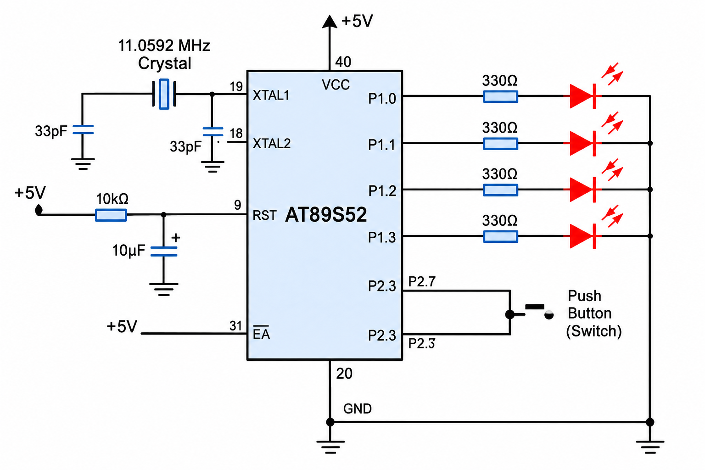

# EXPERIMENT DETAILS

**EXP:** CONTINUOUS ASSESSMENT 3

**DATE:** 27/07/2026

**NAME OF EXP:** Timer-Based LED Pattern Generator and Button Interrupt Controller

**HARDWARE SETUP / PLATFORM:** 8051 Microcontroller (AT89S52) + Keil µVision (Keil C51 Compiler)

---

## TASK: Register-Level Four-State LED Control System

### 1. Circuit Diagram

AT89S52 development board configured with four LEDs connected to four GPIO output pins and one push-button switch connected to a GPIO input pin. Circuit diagram attached.

### 2. Hardware Setup & Operating Modes

| Parameter         | Student Entry                                            |
| ----------------- | -------------------------------------------------------- |
| MCU               | AT89S52                                                  |
| CPU Core          | 8-bit 8051                                               |
| Operating Voltage | 5V                                                       |
| Debug Interface   | Multimeter / Programmer interface (board-dependent)      |
| Output Peripherals| 4 LEDs (Digital Outputs)                                 |
| Input Peripheral  | 1 Push-Button Switch (Digital Input with Debouncing)     |
| Mode 0 (Initial)  | All LEDs OFF (`0000`)                                    |
| Mode 1 (Press 1)  | Running LED Pattern (`LED1 → LED2 → LED3 → LED4 → LED1`) |
| Mode 2 (Press 2)  | Binary Counter (`0000` to `1111`)                        |
| Mode 3 (Press 3)  | Alternating Pattern (`1010` ↔ `0101`)                    |
| Mode 4 (Press 4)  | All LED Flash (`1111` ↔ `0000`)                          |

### 3. Core Logic / Pseudocode

1. Include the required 8051 register header file (`reg51.h` / `reg52.h`).
2. Configure the GPIO pins for the four output LEDs and the push-button input.
3. Initialize the system state to `0` (all LEDs OFF).
4. Poll or detect the push-button press event in the main loop.
5. Apply software debouncing delay upon detecting a press to ensure one physical press causes exactly one state transition.
6. Increment and wrap the operating state variable (`1` through `4`).
7. Execute the corresponding LED pattern routine based on the active state (Running LED, Binary Counter, Alternating Pattern, or All-LED Flash).
8. Repeat continuously inside an infinite loop.

### 4. Program Parameters

| Parameter            | Value                                                      |
| -------------------- | ---------------------------------------------------------- |
| Microcontroller      | AT89S52                                                    |
| Source File          | `4_modes_led_keypad.c`                                     |
| Project File         | `4_modes_Led_keypad.uvproj`                                |
| Programming Language | Bare-Metal Embedded C (Direct Register Access)             |
| Restrictions         | Strictly No Arduino APIs, HAL libraries, or RTOS services  |
| State Transition     | Single transition per debounced push-button press          |
| Execution            | Infinite state-machine loop                                |

### 5. Inference

Successfully designed and implemented a bare-metal, register-level GPIO controller on the AT89S52 microcontroller. Using software switch debouncing and state-machine logic, each valid push-button press cleanly transitions the system across four distinct LED operating modes without external HAL or RTOS libraries.