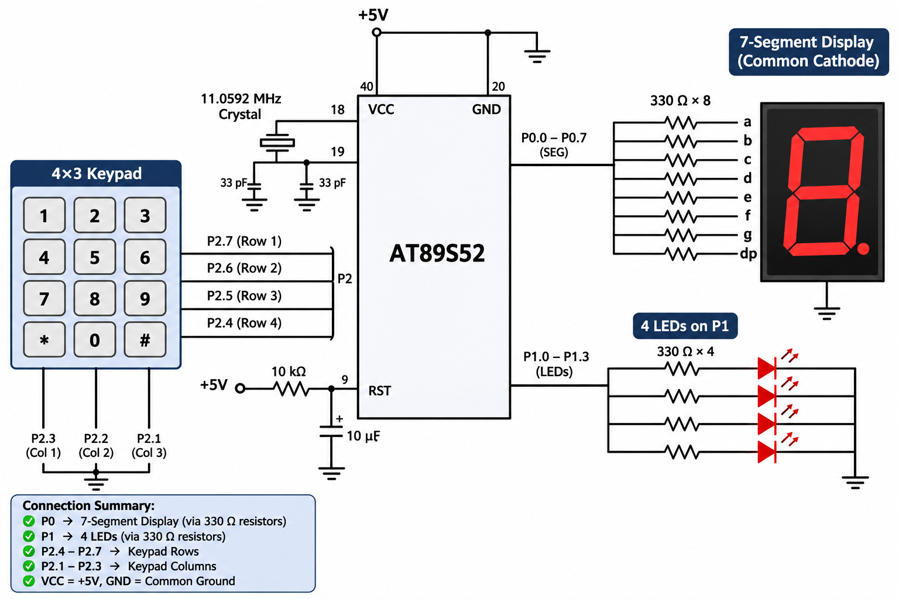

# EXPERIMENT DETAILS

**EXP:** CONTINUOUS ASSESSMENT 4

**DATE:** 03/08/2026

**NAME OF EXP:** Human-Machine Interface using Matrix Keypad, LEDs, and Seven-Segment Display

**HARDWARE SETUP / PLATFORM:** 8051 Microcontroller (AT89S52) + Keil µVision (Keil C51 Compiler)

---

## TASK: Embedded Human-Machine Interface (HMI) Controller

### 1. Circuit Diagram

AT89S52 development board interfaced with a Matrix Keypad (input device), a Seven-Segment Display (visual feedback), and four LEDs (operating mode indicators).

**Circuit Diagram:**

### 2. Hardware Setup & Functional Mapping

| Key Press | Seven-Segment Display | LED Operation |
|---|---|---|
| `1` | `1` | LED1 ON |
| `2` | `2` | LED2 ON |
| `3` | `3` | LED3 ON |
| `4` | `4` | LED4 ON |
| `5` | `5` | Running LED Pattern |
| `6` | `6` | Alternate LEDs (`1010` ↔ `0101`) |
| `7` | `7` | Binary Counter (`0–15`) |
| `8` | `8` | All LEDs Blink |
| `9` | `9` | All LEDs OFF |
| `0` | `0` | Reset System |

### 3. Core Logic / Pseudocode

1. Include the required 8051 register header file (`reg51.h` / `reg52.h`).
2. Initialize GPIO ports for the Matrix Keypad, Seven-Segment Display, and output LEDs.
3. Continuously scan the matrix keypad using `keypad_scan()` to detect valid key presses (`0`–`9`).
4. Upon detecting a valid key press, pass the key value to `display_digit(value)` to render the corresponding digit on the seven-segment display.
5. Pass the key value to `led_control(key)` to trigger the mapped LED operation (`running_led()`, `binary_counter()`, `alternate_led()`, `blink_all()`, individual LEDs, or system reset).
6. Repeat continuously inside an infinite loop.

### 4. Program Parameters

| Parameter | Value |
|---|---|
| Microcontroller | AT89S52 |
| CPU Core | 8-bit 8051 |
| Operating Voltage | 5V |
| Source File | `led_keypad_sevenseg.c` |
| Project File | `Led_keypad_sevenseg.uvproj` |
| Modular Functions | `keypad_scan()`, `display_digit()`, `led_control()`, `running_led()`, `binary_counter()`, `alternate_led()`, `blink_all()` |
| Programming Language | Bare-Metal Embedded C (Direct Register Access) |
| Restrictions | Strictly No Arduino APIs, HAL libraries, or RTOS services |
| Execution | Infinite HMI polling and control loop |

### 5. Inference

Successfully designed and implemented a modular, bare-metal Human-Machine Interface (HMI) on the AT89S52 microcontroller.

Pressing any valid key (`0`–`9`) on the matrix keypad accurately updates the seven-segment display and executes the corresponding LED pattern or control mode through dedicated C functions without relying on external HAL or RTOS libraries.
