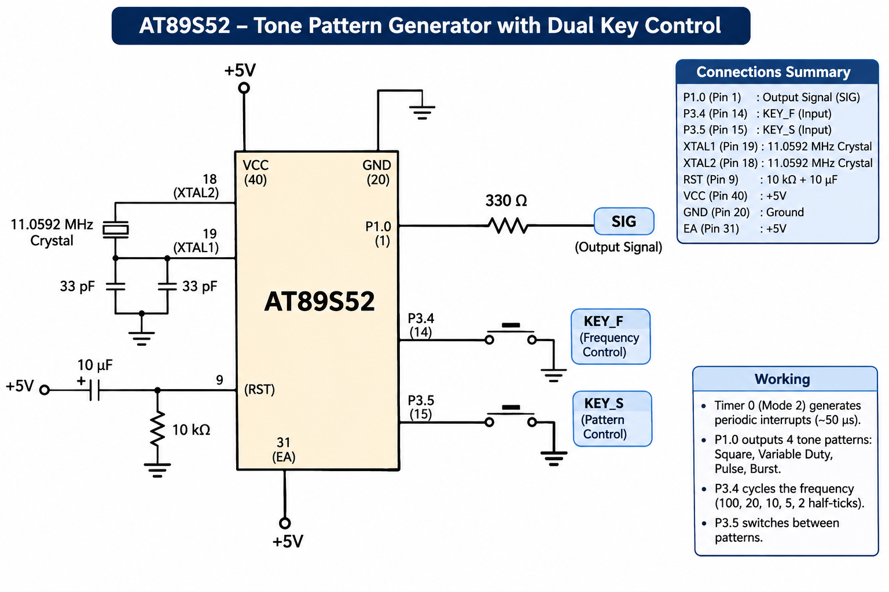

# EXPERIMENT DETAILS

**EXP:** CONTINUOUS ASSESSMENT 5 – TASK 2B

**DATE:** 10/08/2026

**NAME OF EXP:** Timer-Interrupt-Driven Variable-Frequency Square Wave and Waveform Generation

**HARDWARE SETUP / PLATFORM:** 8051 Microcontroller (AT89S52) + Keil µVision (Keil C51 Compiler)

---

## TASK 2B: Variable-Frequency Square Wave & Custom Waveform Generation

### 1. Circuit Diagram

AT89S52 development board configured with an 11.0592 MHz crystal oscillator and a GPIO output pin routed to an oscilloscope probe for frequency and duty-cycle verification.

**Circuit Diagram:**

### 2. Frequency Modes & Waveform Specifications

| Parameter / Mode | Specification / Bit Pattern |
|---|---|
| MCU | AT89S52 (11.0592 MHz Crystal) |
| Timer Peripheral | Hardware Timer 0 Interrupt |
| Mode 1 Frequency | 100 Hz |
| Mode 2 Frequency | 500 Hz |
| Mode 3 Frequency | 1 kHz |
| Mode 4 Frequency | 2 kHz |
| Mode 5 Frequency | 5 kHz |
| Waveform 1: Square Wave | `101010101010` (50% duty cycle) |
| Waveform 2: Variable Duty-Cycle | `1111000011110000` |
| Waveform 3: Pulse Train | `100000001000000010000000` |
| Waveform 4: Burst Signal | `1010101010 0000000000 1010101010` |

### 3. Core Logic / Pseudocode

1. Include the required 8051 register header file (`reg51.h` / `reg52.h`).
2. Configure a GPIO pin as a digital signal output and initialize Timer 0 in 16-bit timer mode.
3. Calculate and load timer reload values (`TH0`, `TL0`) corresponding to the target output frequency (100 Hz to 5 kHz).
4. Enable Timer 0 and global interrupts (`ET0 = 1`, `EA = 1`) to generate periodic hardware timing events.
5. Inside the Timer 0 ISR, reload the timer count and update the GPIO output pin state according to the selected frequency mode or bit-pattern sequence (Square Wave, Variable Duty-Cycle, Pulse Train, or Burst Signal).
6. Verify output frequency, period, and duty cycle on an oscilloscope.

### 4. Program Parameters

| Parameter | Value |
|---|---|
| Microcontroller | AT89S52 |
| Source File | `waveforms.c` |
| Project File | `Task 2B (waveforms).uvproj` |
| Timing Mechanism | Hardware Timer 0 Interrupt (Non-Blocking) |
| Programming Language | Bare-Metal Embedded C (Direct Register Access) |
| Restrictions | Strictly No Arduino APIs, HAL libraries, or RTOS services |
| Verification Instrument | Digital Storage Oscilloscope (Frequency & Duty Cycle) |

### 5. Inference

Successfully generated precise variable-frequency square waves (100 Hz, 500 Hz, 1 kHz, 2 kHz, and 5 kHz) as well as multi-pattern digital waveforms (variable duty cycle, pulse train, and burst signals) using Timer 0 interrupts on the AT89S52.

Hardware timer reloads ensured deterministic timing without blocking CPU execution.
