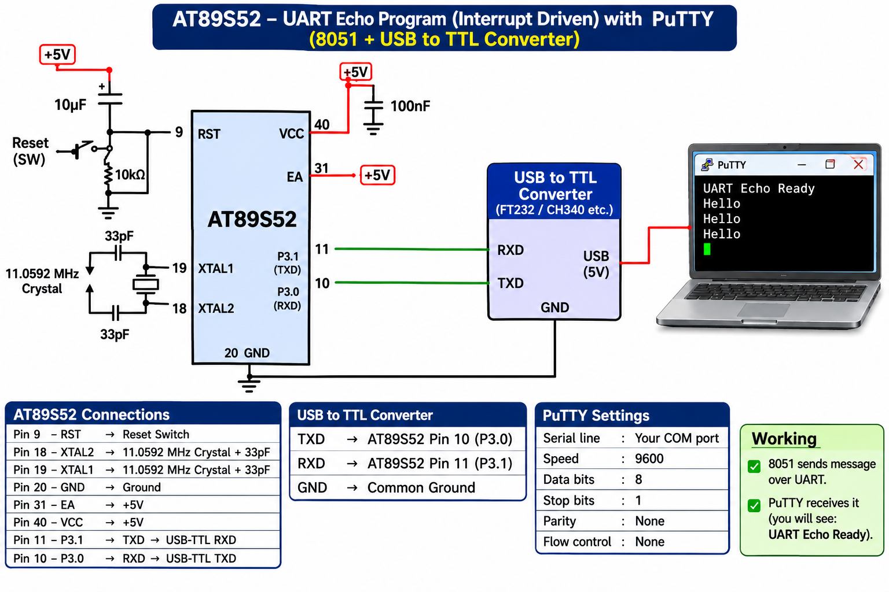

# EXPERIMENT DETAILS

**EXP:** CONTINUOUS ASSESSMENT 6

**DATE:** 17/08/2026

**NAME OF EXP:** UART Driver and Serial Debugging – Task B: Interrupt-Driven UART Echo

**HARDWARE SETUP / PLATFORM:** 8051 Microcontroller (AT89S52) + Keil µVision (Keil C51 Compiler) + USB-to-TTL Converter + PuTTY

---

## TASK B: UART Echo (Interrupt-Driven)

### 1. Circuit Diagram

AT89S52 development board connected to a PC via a USB-to-TTL serial converter. Pin `P3.1` (TXD) connects to the converter's RX pin, pin `P3.0` (RXD) connects to the converter's TX pin, and both share a common GND.

**Circuit Diagram:**

### 2. Core Logic / Pseudocode

1. Include the required 8051 register header file (`reg51.h` / `reg52.h`).
2. Configure Timer 1 in Mode 2 (8-bit auto-reload) using `TMOD = 0x20` and load `TH1 = 0xFD` for 9600 baud with an 11.0592 MHz crystal.
3. Configure `SCON = 0x50` to select 8-bit asynchronous UART (Mode 1) and enable serial reception (`REN = 1`).
4. Enable global interrupts (`EA = 1`) and serial port interrupts (`ES = 1`), then start Timer 1 (`TR1 = 1`).
5. Implement the Serial Interrupt Service Routine (`void serial_ISR(void) interrupt 4`).
6. Inside the ISR, check whether the Receive Interrupt flag (`RI`) is set:
   - Read the incoming character from `SBUF` (or push it into an RX ring buffer).
   - Clear `RI = 0` in software.
   - Write the received byte back to `SBUF` to echo it to the PC terminal.
7. If `TI` triggers inside the ISR, clear `TI = 0` in software to prepare the transmitter for subsequent bytes.
8. Keep the `main()` function running in a non-blocking idle loop while interrupts handle real-time echoing.

### 3. Program Parameters

| Parameter | Value |
|---|---|
| Microcontroller | AT89S52 |
| Crystal Frequency | 11.0592 MHz |
| Header File | `reg51.h` / `reg52.h` |
| UART Pins | TXD (`P3.1`), RXD (`P3.0`) |
| Serial Mode (`SCON`) | `0x50` (Mode 1: 8-bit UART, REN = 1) |
| Timer Configuration (`TMOD`) | `0x20` (Timer 1, Mode 2: 8-bit Auto-Reload) |
| Baud Rate Reload (`TH1`) | `0xFD` (9600 bps) |
| Framing Format | 9600-8-N-1 (8 data bits, No parity, 1 stop bit) |
| Interrupt Enable (`IE`) | `EA = 1`, `ES = 1` (Vector `interrupt 4`) |
| Receive / Transmit Flags | `RI`, `TI` (cleared manually in ISR) |
| Operation Mode | Full-duplex interrupt-driven character echo |
| Programming Language | Embedded C (Bare-Metal) |

### 4. Inference

Successfully developed an interrupt-driven UART echo driver on the AT89S52 microcontroller configured at 9600-8-N-1.

Characters typed in PuTTY (such as `ABC123` and `Hello 8051`) trigger the serial ISR upon arrival, are read from `SBUF`, and are echoed back to the terminal without blocking CPU execution.
