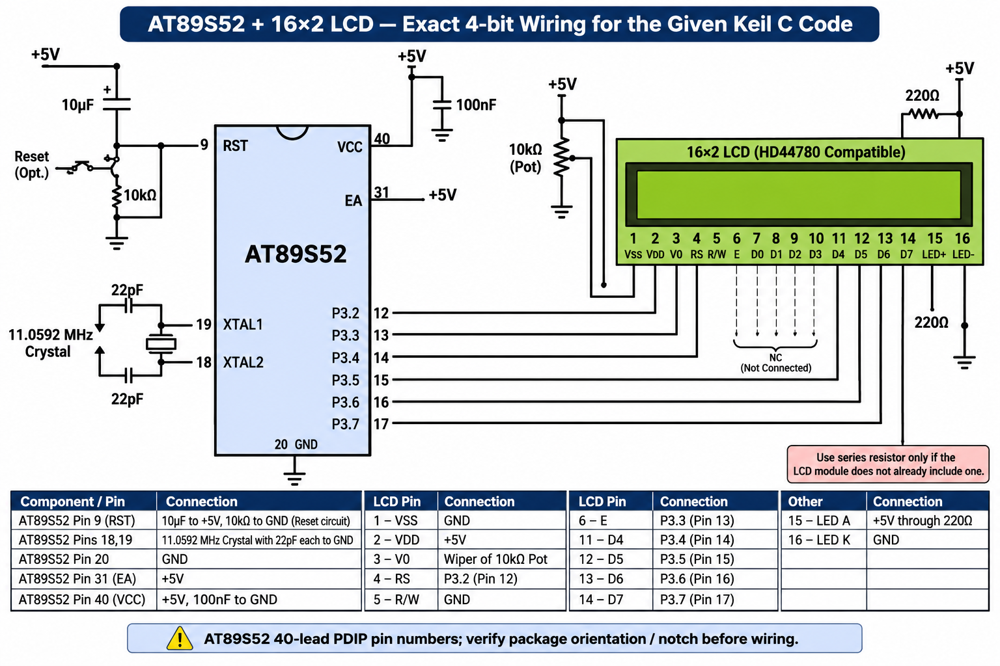

# EXPERIMENT DETAILS

**EXP:** CONTINUOUS ASSESSMENT 7 – TASK 7A

**DATE:** 24/08/2026

**NAME OF EXP:** 16x2 LCD Driver Development – Task 7A: LCD Initialization and Character/String Display

**HARDWARE SETUP / PLATFORM:** 8051 Microcontroller (AT89S52) + 16x2 LCD (HD44780 Controller) + Keil µVision (Keil C51 Compiler)

---

## TASK 7A: LCD Initialization and Character/String Display

### 1. Circuit Diagram

AT89S52 development board interfaced with a $16\times2$ LCD (HD44780 compatible) configured in 4-bit mode. Control pins (`RS`, `E`) and data pins (`D4`–`D7`) are connected to designated GPIO port pins, with contrast adjusted via a potentiometer. Circuit diagram attached.

### 2. Core Logic / Pseudocode

1. Include the required 8051 register header file (`reg51.h` / `reg52.h`).
2. Define GPIO pin mappings for control signals (`RS`, `E`) and 4-bit data bus (`D4`–`D7`).
3. Implement a microsecond/millisecond delay routine required for LCD timing compliance.
4. Develop `lcd_cmd(unsigned char cmd)` to send initialization and configuration commands in two 4-bit nibbles.
5. Develop `lcd_data(unsigned char dat)` to send ASCII characters to the LCD DDRAM in two 4-bit nibbles.
6. Implement `lcd_init()` to send the precise HD44780 initialization command sequence: power-on delay, function set ($4\text{-bit}$, $2\text{-line}$, $5\times8\text{ font}$), display control (display ON, cursor/blink settings), entry mode set, and display clear.
7. Write main test logic to display individual characters (e.g., `'A'`) and strings across both rows of the $16\times2$ display.

### 3. Program Parameters

| Parameter | Value |
| --- | --- |
| Microcontroller | AT89S52 |
| LCD Controller | HD44780 Compatible ($16\times2$ Character LCD) |
| Interface Mode | 4-Bit Parallel Interface (`D4`–`D7`, `RS`, `E`) |
| Source File | `lcd_init_dispay.c` |
| Project File | `LCD_Int_display.uvproj` |
| Key Functions | `lcd_init()`, `lcd_cmd()`, `lcd_data()` |
| Programming Language | Bare-Metal Embedded C (Direct Register Access) |
| Restrictions | Strictly No Arduino APIs, HAL libraries, or RTOS services |
| Execution | Static message display on rows 1 and 2 |

### 4. Inference

Successfully developed a low-level, bare-metal 4-bit LCD driver for the AT89S52 microcontroller based on the HD44780 datasheet specifications. The LCD was successfully initialized and verified by rendering custom characters and multi-row strings without relying on external libraries.