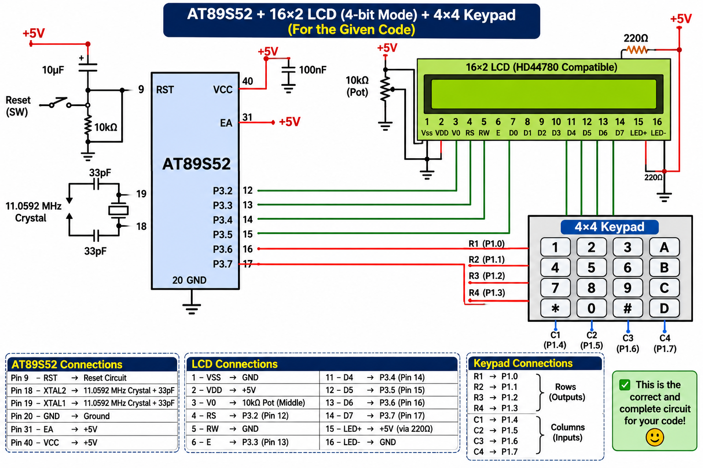

# EXPERIMENT DETAILS

**EXP:** CONTINUOUS ASSESSMENT 7 – TASK 7C

**DATE:** 24/08/2026

**NAME OF EXP:** 16x2 LCD Driver Development – Task 7C: 4x4 Keypad-Based Character Movement

**HARDWARE SETUP / PLATFORM:** 8051 Microcontroller (AT89S52) + 16x2 LCD + 4x4 Matrix Keypad + Keil µVision (Keil C51 Compiler)

---

## TASK 7C: 4x4 Keypad-Based Character Movement

### 1. Circuit Diagram

AT89S52 development board interfaced with a 16×2 LCD and a 4×4 matrix keypad. Keypad rows and columns are mapped to designated 8051 GPIO ports with software debouncing.

**Circuit Diagram:**

### 2. Functional Key Mapped Controls

| Key | Directional Action | DDRAM Coordinate Shift |
|---|---|---|
| `2` | Move Up (↑) | Row decreases by 1 (if `row > 0`) |
| `8` | Move Down (↓) | Row increases by 1 (if `row < 1`) |
| `4` | Move Left (←) | Column decreases by 1 (if `col > 0`) |
| `6` | Move Right (→) | Column increases by 1 (if `col < 15`) |

### 3. Core Logic / Pseudocode

1. Include the 8051 register header file and integrate the 4-bit LCD driver (`lcd_init`, `lcd_goto`, `lcd_data`).
2. Initialize GPIO ports for scanning the 4×4 matrix keypad with switch debouncing logic.
3. Maintain state variables for the current cursor coordinates (`row` initialized to `0`, `column` initialized to `0`).
4. Clear the screen and render a designated tracking character (e.g., `'*'` or `'X'`) at the initial coordinate position using `lcd_goto(row, column)`.
5. Continuously scan the keypad in the main loop for valid directional inputs (`2`, `8`, `4`, `6`).
6. Upon detecting a valid key press, erase the previous position, update the `row` or `column` variables within display boundary limits (0–1 for rows, 0–15 for columns), and redraw the character at the new coordinate location.

### 4. Program Parameters

| Parameter | Value |
|---|---|
| Microcontroller | AT89S52 |
| Peripherals | 16×2 LCD + 4×4 Matrix Keypad |
| Source File | `lcd.c` |
| Project File | `LCD.uvproj` |
| Directional Mapping | `2` (Up), `8` (Down), `4` (Left), `6` (Right) |
| Programming Language | Bare-Metal Embedded C (Direct Register Access) |
| Restrictions | Strictly No Arduino APIs, HAL libraries, or RTOS services |
| Execution | Interactive real-time character relocation loop |

### 5. Inference

Successfully developed an interactive embedded application combining the 4×4 keypad and 16×2 LCD driver.

User
