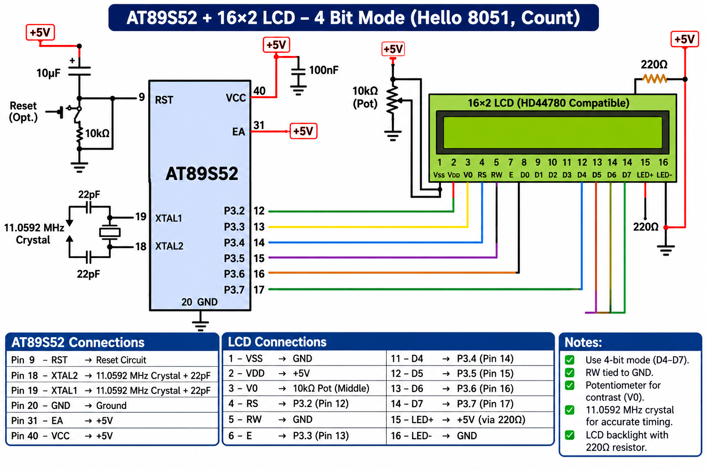

# EXPERIMENT DETAILS

**EXP:** CONTINUOUS ASSESSMENT 7 – TASK 7B

**DATE:** 24/08/2026

**NAME OF EXP:** 16x2 LCD Driver Development – Task 7B: Cursor Positioning and Dynamic Value Update

**HARDWARE SETUP / PLATFORM:** 8051 Microcontroller (AT89S52) + 16x2 LCD (HD44780 Controller) + Keil µVision (Keil C51 Compiler)

---

## TASK 7B: Cursor Positioning and Dynamic Value Update

### 1. Circuit Diagram

AT89S52 development board interfaced with a 16×2 LCD in 4-bit mode. Connections include control pins (`RS`, `E`) and data bus (`D4`–`D7`) linked to 8051 port pins.

**Circuit Diagram:**

### 2. Core Logic / Pseudocode

1. Include the required 8051 register header file and the base 4-bit LCD driver functions (`lcd_cmd`, `lcd_data`).
2. Implement `lcd_goto(unsigned char row, unsigned char column)` to calculate the correct DDRAM address offset (0-indexed for rows 0–1 and columns 0–15) and send the set DDRAM address command (`0x80` for row 0, `0xC0` for row 1).
3. Implement `lcd_puts(char *s)` to iterate through a null-terminated string and transmit each character using `lcd_data()`.
4. Implement `lcd_print_number(unsigned int value)` to convert numeric integer values into ASCII character streams and render them dynamically on the LCD screen.
5. In the main application loop, continuously update sensor or counter values at specific screen coordinates without flickering or requiring full-screen redraws.

### 3. Program Parameters

| Parameter | Value |
|---|---|
| Microcontroller | AT89S52 |
| LCD Controller | HD44780 Compatible (16×2 Character LCD) |
| Interface Mode | 4-Bit Parallel Interface (`D4`–`D7`, `RS`, `E`) |
| Source File | `cursor.c` |
| Project File | `cursor.uvproj` |
| Key Functions | `lcd_goto()`, `lcd_puts()`, `lcd_print_number()` |
| Programming Language | Bare-Metal Embedded C (Direct Register Access) |
| Restrictions | Strictly No Arduino APIs, HAL libraries, or RTOS services |
| Execution | Dynamic cursor relocation and numerical data refresh |

### 4. Inference

Successfully extended the 4-bit LCD driver with cursor positioning and formatting routines (`lcd_goto`, `lcd_puts`, `lcd_print_number()`).

This enabled precise coordinate-based string output and real-time numerical updates on the 16×2 display.
