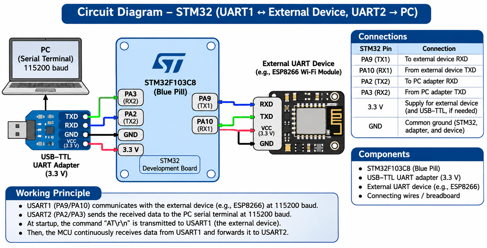

# EXPERIMENT DETAILS

**EXP:** CONTINUOUS LAB EVALUATION 10

**DATE:** 05/10/2026

**NAME OF EXP:** STM32–Wemos Wi-Fi Modem Interface Using AT Commands

**HARDWARE SETUP / PLATFORM:** STM32 Development Board + Wemos D1 Mini (ESP8266) + STM32CubeMX + Keil MDK

---

## TASK 9A : Establish STM32 ↔ Wemos UART Communication

### 1. Circuit Diagram

The experiment establishes UART communication between an STM32 microcontroller and a Wemos D1 Mini (ESP8266).

**Connections:**

| Wemos D1 Mini | STM32 | Description |
|---|---|---|
| TX | RX (e.g., PA3 / USART2_RX) | Wemos to STM32 |
| RX | TX (e.g., PA2 / USART2_TX) | STM32 to Wemos |
| GND | GND | Common ground |
| 5V / 3.3V | Appropriate power source | Power supply |

### 2. Core Logic / Pseudocode / Code Base

**Working Principle:**

The STM32 microcontroller communicates with the Wemos D1 Mini through UART.

The STM32 transmits the `AT` command followed by carriage return and line feed (`\r\n`) to the ESP8266 modem.

The Wemos processes the command and sends a response through UART.

The STM32 receives the response and displays it on a PC serial terminal.

**Pseudocode:**

1. Initialize the STM32 HAL library.
2. Configure the system clock.
3. Initialize UART communication.
4. Connect STM32 TX to Wemos RX.
5. Connect STM32 RX to Wemos TX.
6. Establish a common ground.
7. Transmit `AT\r\n` from STM32 to Wemos.
8. Receive the Wemos response through UART.
9. Display the response on the PC terminal.
10. Verify communication using the expected `OK` response.

**Code Base:**

- `HAL_Init()` initializes the STM32 HAL library.
- `SystemClock_Config()` configures the system clock.
- `HAL_UART_Transmit()` sends the AT command to the Wemos module.
- `HAL_UART_Receive()` receives the modem response.
- UART communication is used to display the received response on a PC terminal.
- `AT\r\n` is used to verify modem communication.

### 3. Inference

The experiment demonstrates UART communication between an STM32 microcontroller and a Wemos D1 Mini using transmit, receive, and common-ground connections.

The `AT` command and expected `OK` response provide a method for verifying communication between the two boards.
