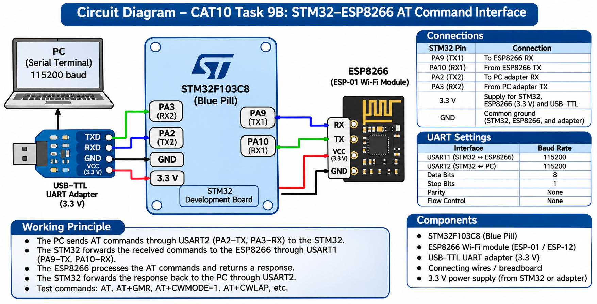

# EXPERIMENT DETAILS

**EXP:** CONTINUOUS LAB EVALUATION 10

**DATE:** 05/10/2026

**NAME OF EXP:** STM32–Wemos Wi-Fi Modem Interface Using AT Commands

**HARDWARE SETUP / PLATFORM:** STM32 Microcontroller, ESP8266 / Wemos Wi-Fi Module, USB-to-TTL Serial Interface, STM32CubeMX, Keil µVision, Embedded C, STM32 HAL Libraries

---

## TASK 9B : Exploring ESP8266 AT Commands

### 1. Circuit Diagram

The STM32 microcontroller communicates with the ESP8266 Wi-Fi module using UART.

**Hardware Connections:**

| STM32 | ESP8266 / Wemos |
|---|---|
| PA9 (USART1 TX) | RX |
| PA10 (USART1 RX) | TX |
| GND | GND |
| 3.3 V supply | Appropriate 3.3 V power input |

For displaying responses on a PC, USART2 can be connected to a USB-to-TTL serial adapter.

| STM32 | USB-to-TTL Adapter |
|---|---|
| PA2 (USART2 TX) | RX |
| PA3 (USART2 RX) | TX |
| GND | GND |



### 2. Core Logic / Pseudocode / Code Base

**Working Principle:**

The experiment explores communication between an STM32 microcontroller and an ESP8266 Wi-Fi module using AT commands.

The STM32 transmits commands through USART1. The ESP8266 processes these commands and returns responses through UART.

The received responses can be forwarded through USART2 to a computer for monitoring.

The following AT commands are studied:

| AT Command | Purpose |
|---|---|
| `AT` | Check communication with ESP8266 |
| `AT+GMR` | Display firmware version |
| `AT+CWMODE=1` | Configure station mode |
| `AT+CWLAP` | Scan available Wi-Fi networks |

**Pseudocode:**

1. Start the program.
2. Initialize the STM32 HAL library.
3. Configure the system clock.
4. Initialize GPIO, USART1, and USART2.
5. Configure both UART interfaces with the required baud rate.
6. Send an AT command to ESP8266 through USART1.
7. Receive the response from ESP8266.
8. Forward the received response to the PC through USART2.
9. Repeat for the remaining AT commands.
10. Observe and interpret the responses.

**Code Base:**

**UART Initialization:**

```c
HAL_Init();
SystemClock_Config();
MX_GPIO_Init();
MX_USART1_UART_Init();
MX_USART2_UART_Init();
```

**AT Command Transmission:**

```c
char *cmd = "AT\r\n";

HAL_UART_Transmit(
    &huart1,
    (uint8_t *)cmd,
    strlen(cmd),
    HAL_MAX_DELAY
);
```

**Forwarding ESP8266 Responses to PC:**

```c
uint8_t rx;

while (1)
{
    if (HAL_UART_Receive(
            &huart1,
            &rx,
            1,
            HAL_MAX_DELAY) == HAL_OK)
    {
        HAL_UART_Transmit(
            &huart2,
            &rx,
            1,
            HAL_MAX_DELAY
        );
    }
}
```

**Expected Responses:**

```text
AT
OK

AT+GMR
<Firmware Version Information>
OK

AT+CWMODE=1
OK

AT+CWLAP
<Available Wi-Fi Networks>
OK
```

**Note:** The supplied code sends only the `AT` command automatically. The other commands are part of the experiment but require additional transmission logic or a suitable interactive UART interface.

### 3. Inference

The experiment demonstrates UART-based communication between the STM32 microcontroller and ESP8266 Wi-Fi module.

AT commands provide a way to verify communication, identify firmware information, configure Wi-Fi operating modes, and discover available wireless networks.

The task develops an understanding of serial communication and the use of AT commands for Wi-Fi module configuration.