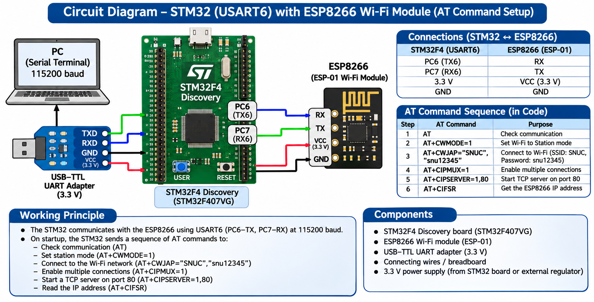

# EXPERIMENT DETAILS

**EXP:** CONTINUOUS LAB EVALUATION 10C

**DATE:** 12/10/2026

**NAME OF EXP:** HTTP Server – STM32–Wemos Wi-Fi Modem Using AT Commands

**HARDWARE SETUP / PLATFORM:** STM32 Development Board + Wemos D1 Mini (ESP8266) + STM32CubeMX + Keil MDK

---

## TASK 10C : Configure ESP8266 as a TCP Server

### 1. Circuit Diagram

The STM32 communicates with the ESP8266/Wemos module through UART. The ESP8266 is configured to operate as a TCP server on port 80.

**Connections:**

- STM32 TX → ESP8266 RX
- STM32 RX → ESP8266 TX
- STM32 GND → ESP8266 GND
- Provide the appropriate power supply to both boards.



### 2. Core Logic / Pseudocode / Code Base

**Working Principle:**

The STM32 sends AT commands to the ESP8266 through UART to configure it as a TCP server.

The `AT` command checks communication with the modem. The `AT+CIPMUX=1` command enables multiple connections, and `AT+CIPSERVER=1,80` starts a TCP server on port 80.

**Pseudocode:**

1. Initialize the STM32 HAL library.
2. Configure the system clock and UART peripheral.
3. Establish UART communication with the ESP8266.
4. Send the `AT` command to check modem communication.
5. Send `AT+CIPMUX=1` to enable multiple connections.
6. Send `AT+CIPSERVER=1,80` to start the TCP server.
7. Receive and inspect the ESP8266 responses.
8. Keep the server ready to accept incoming connections.

**Code Base:**

AT commands used:

```text
AT
AT+CIPMUX=1
AT+CIPSERVER=1,80
```

Relevant STM32 HAL functions:

- `HAL_Init()`
- `SystemClock_Config()`
- `HAL_UART_Transmit()`
- `HAL_UART_Receive()`

### 3. Inference

The experiment demonstrates how an STM32 microcontroller can configure an ESP8266/Wemos module as a TCP server using UART AT commands.

The configured server can accept incoming network connections on port 80, providing the foundation for an STM32-based HTTP sensor node.