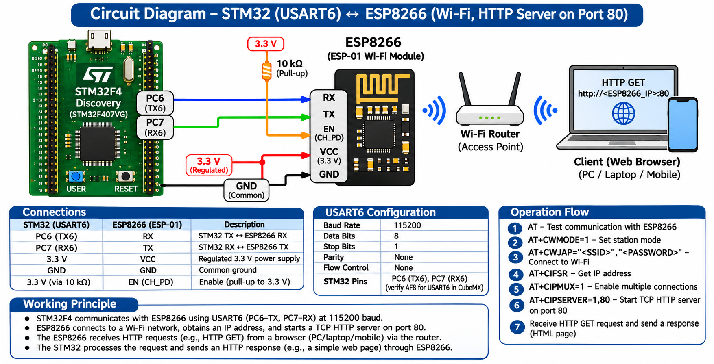

# EXPERIMENT DETAILS

**EXP:** CONTINUOUS LAB EVALUATION 10C

**DATE:** 12/10/2026

**NAME OF EXP:** HTTP Server – STM32–Wemos Wi-Fi Modem Using AT Commands

**HARDWARE SETUP / PLATFORM:** STM32 Development Board + Wemos D1 Mini (ESP8266) + STM32CubeMX + Keil MDK

---

## TASK 10D : Observe the HTTP Request and Construct a Static HTTP Response

### 1. Circuit Diagram

The STM32 communicates with the ESP8266 through UART. A browser sends an HTTP request to the ESP8266 TCP server, which forwards the request data to the STM32.

The STM32 constructs an HTTP response and sends it back through the ESP8266.

**Connections:**

- STM32 TX → ESP8266 RX
- STM32 RX → ESP8266 TX
- STM32 GND → ESP8266 GND
- Browser → Wi-Fi Network → ESP8266 → STM32



### 2. Core Logic / Pseudocode / Code Base

**Working Principle:**

When a browser sends an HTTP GET request to the ESP8266 server, the ESP8266 forwards the received data to the STM32 using an `+IPD` notification.

The STM32 identifies the incoming request, constructs an HTTP response containing a status line, headers, a blank line, and an HTML body, and transmits it to the browser through the ESP8266.

The response is sent using the `AT+CIPSEND` command followed by the HTTP response data.

**Pseudocode:**

1. Initialize the STM32 UART peripheral.
2. Configure the ESP8266 as a TCP server.
3. Wait for an incoming browser request.
4. Receive the `+IPD` notification from the ESP8266.
5. Identify the connection ID and incoming HTTP request.
6. Construct a static HTML response.
7. Calculate the HTTP response length.
8. Send `AT+CIPSEND=<link_id>,<data_length>`.
9. Wait for the ESP8266 `>` prompt.
10. Transmit the HTTP response through UART.
11. View the returned HTML page in the browser.

**Code Base:**

Example incoming request:

```text
+IPD,0,XXX:GET / HTTP/1.1
Host: 192.168.1.105
```

CIPSEND command:

```c
sprintf(cmd, "AT+CIPSEND=%d,%d\r\n",
        link_id, data_length);
```

HTTP response construction:

```c
sprintf(response,
        "HTTP/1.1 200 OK\r\n"
        "Content-Type: text/html\r\n"
        "Content-Length: %d\r\n"
        "\r\n"
        "<html><body><h1>STM32 IoT Node</h1></body></html>",
        body_length);
```

The ESP8266 must provide the `>` prompt before the STM32 transmits the HTTP response data.

### 3. Inference

The experiment demonstrates how an STM32 microcontroller can process HTTP requests received through an ESP8266 Wi-Fi module.

The STM32 can construct a valid HTTP response containing HTML content and transmit it to a browser using the ESP8266 TCP connection.