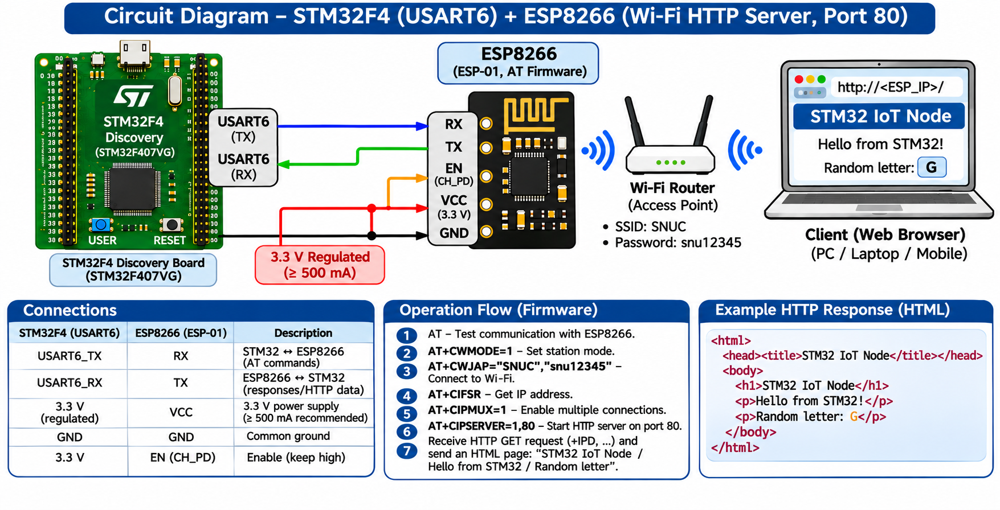

# EXPERIMENT DETAILS

**EXP:** CONTINUOUS LAB EVALUATION 10C

**DATE:** 12/10/2026

**NAME OF EXP:** HTTP Server – STM32–Wemos Wi-Fi Modem Using AT Commands

**HARDWARE SETUP / PLATFORM:** STM32 Development Board + Wemos D1 Mini (ESP8266) + STM32CubeMX + Keil MDK + Node-RED

---

## TASK 10E : Node-RED as a Second HTTP Client of STM32/ESP8266 HTTP Server

### 1. Circuit Diagram

The STM32 communicates with the ESP8266 through UART. The ESP8266 operates as an HTTP server, while Node-RED acts as an HTTP client.

Node-RED sends an HTTP request to the ESP8266 server and displays the received response.

**Connections:**

- STM32 TX → ESP8266 RX
- STM32 RX → ESP8266 TX
- STM32 GND → ESP8266 GND
- Node-RED → Wi-Fi Network → ESP8266 → STM32

**Node-RED Flow:**

```text
[Inject] → [HTTP Request] → [Debug]
```



### 2. Core Logic / Pseudocode / Code Base

**Working Principle:**

The STM32 and ESP8266 together operate as an HTTP server.

Node-RED is configured as a second HTTP client using an Inject node, an HTTP Request node, and a Debug node.

The Inject node triggers an HTTP request. The HTTP Request node sends the request to the ESP8266 server IP address. The Debug node displays the HTTP response returned by the STM32-based server.

**Pseudocode:**

1. Configure the STM32 and ESP8266 as an HTTP server.
2. Open the Node-RED editor.
3. Add an Inject node.
4. Add an HTTP Request node.
5. Add a Debug node.
6. Connect the nodes in sequence.
7. Configure the HTTP Request node with the ESP8266 IP address.
8. Deploy the Node-RED flow.
9. Trigger the Inject node.
10. Observe the HTTP response in the Debug panel.

**Code Base:**

Node-RED flow:

```text
Inject → HTTP Request → Debug
```

HTTP Request node URL:

```text
http://<ESP8266_IP>/
```

Example HTML response from the STM32 server:

```html
<html>
  <body>
    <h1>STM32 IoT Node</h1>
  </body>
</html>
```

**Node-RED Node Configuration:**

- **Inject Node:** Triggers the HTTP request.
- **HTTP Request Node:** Sends the request to the ESP8266 server.
- **Debug Node:** Displays the HTTP response received from the server.

### 3. Inference

The experiment demonstrates how Node-RED can communicate with an STM32-based HTTP server through an ESP8266 Wi-Fi module.

Node-RED acts as an additional HTTP client and provides a way to request and display data from the STM32/ESP8266 server.