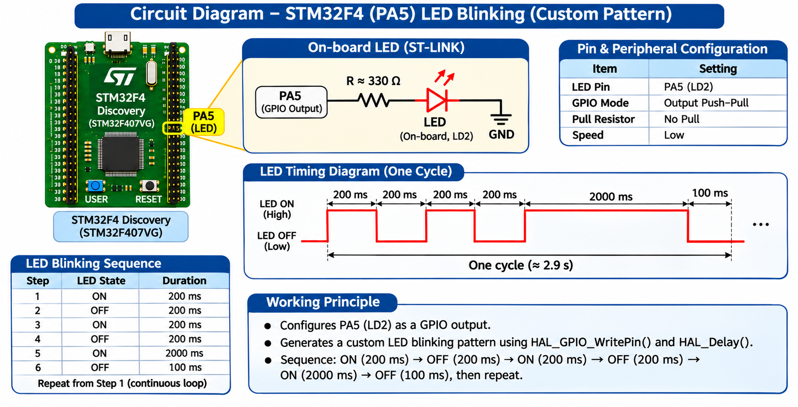

# EXPERIMENT DETAILS

**EXP:** CONTINUOUS LAB EVALUATION 11

**DATE:** 14/10/2026

**NAME OF EXP:** STM32F401RE Cortex-M4: GPIO and User Input Programming

**HARDWARE SETUP / PLATFORM:** STM32 NUCLEO-F401RE Development Board + STM32CubeMX + Keil MDK + STM32 HAL Libraries

---

## TASK 1 : On-board LED Bring-Up

### 1. Circuit Diagram

The on-board user LED (LD2), connected to PA5 on the STM32 NUCLEO-F401RE board, is used to verify GPIO output operation.



### 2. Core Logic / Pseudocode / Code Base

**Working Principle:**

The STM32 microcontroller controls its on-board LED through a GPIO output pin.

The GPIO pin is configured as an output, and the LED is toggled at regular intervals using STM32 HAL functions.

**Pseudocode:**

1. Initialize the STM32 HAL library.
2. Configure the system clock.
3. Enable the GPIO peripheral clock.
4. Configure PA5 as a GPIO output.
5. Enter an infinite loop.
6. Toggle the LED state.
7. Introduce a delay.
8. Repeat continuously.

**Code Base:**

```c
while (1)
{
    HAL_GPIO_TogglePin(GPIOA, GPIO_PIN_5);
    HAL_Delay(500);
}
```

### 3. Inference

The task demonstrates GPIO output programming using the STM32 NUCLEO-F401RE development board.

Periodic LED toggling provides a basic method for verifying the microcontroller's GPIO functionality.