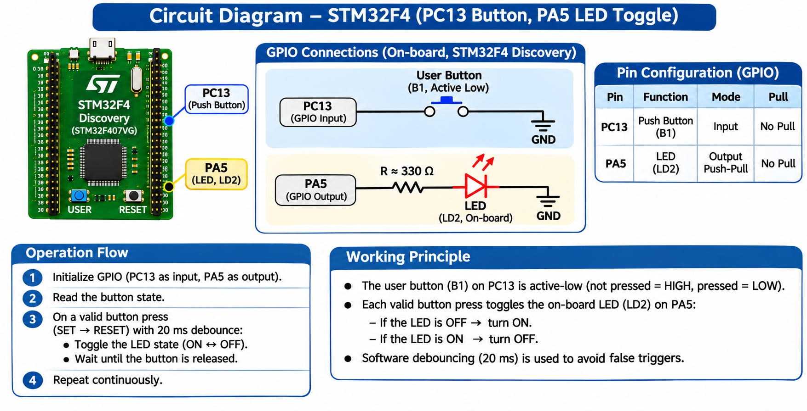

# EXPERIMENT DETAILS

**EXP:** CONTINUOUS LAB EVALUATION 11

**DATE:** 14/10/2026

**NAME OF EXP:** STM32F401RE Cortex-M4: GPIO and User Input Programming

**HARDWARE SETUP / PLATFORM:** STM32 NUCLEO-F401RE Development Board + STM32CubeMX + Keil MDK + STM32 HAL Libraries

---

## TASK 2 : On-board Switch Control with State Remembrance

### 1. Circuit Diagram

The on-board user button (B1) is used to control the on-board user LED (LD2).

**Pin Connections:**

- PA5 — On-board LED (LD2)
- PC13 — On-board push button (B1)



### 2. Core Logic / Pseudocode / Code Base

**Working Principle:**

The STM32 reads the on-board push button through a GPIO input pin.

When a new button press is detected, the LED state is toggled. The LED retains its state after the button is released.

A debounce delay and release detection help prevent multiple toggles from a single press.

**Pseudocode:**

1. Initialize the STM32 HAL library.
2. Configure the system clock.
3. Configure PA5 as a GPIO output.
4. Configure PC13 as a GPIO input.
5. Initialize a variable to remember the LED state.
6. Monitor the push button continuously.
7. Detect a new button press.
8. Apply a debounce delay.
9. Toggle the stored LED state.
10. Update the LED output.
11. Wait for the button to be released.

**Code Base:**

```c
uint8_t led_state = 0;

while (1)
{
    if (HAL_GPIO_ReadPin(GPIOC, GPIO_PIN_13)
        == GPIO_PIN_SET)
    {
        HAL_Delay(20);

        if (HAL_GPIO_ReadPin(GPIOC, GPIO_PIN_13)
            == GPIO_PIN_SET)
        {
            led_state = !led_state;

            HAL_GPIO_WritePin(
                GPIOA,
                GPIO_PIN_5,
                led_state ? GPIO_PIN_SET : GPIO_PIN_RESET
            );

            while (HAL_GPIO_ReadPin(GPIOC, GPIO_PIN_13)
                   == GPIO_PIN_SET)
            {
            }
        }
    }
}
```

### 3. Inference

The task demonstrates GPIO input detection and LED state control using the STM32 microcontroller.

The LED remains in its most recently selected state after the button is released, demonstrating state remembrance.