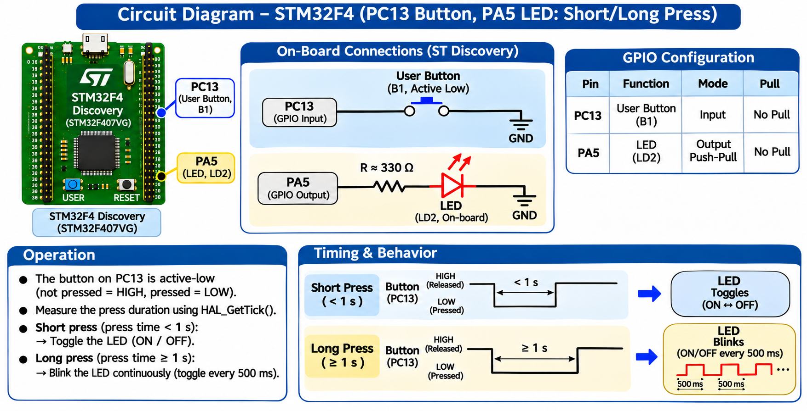

# EXPERIMENT DETAILS

**EXP:** CONTINUOUS LAB EVALUATION 11

**DATE:** 14/10/2026

**NAME OF EXP:** STM32F401RE Cortex-M4: GPIO and User Input Programming

**HARDWARE SETUP / PLATFORM:** STM32 NUCLEO-F401RE Development Board + STM32CubeMX + Keil MDK + STM32 HAL Libraries

---

## TASK 3 : Short-Press and Long-Press Detection

### 1. Circuit Diagram

The on-board user button is used to detect different press durations. The on-board LED indicates the action associated with the detected press.

**Pin Connections:**

- PA5 — On-board LED (LD2)
- PC13 — On-board push button (B1)



### 2. Core Logic / Pseudocode / Code Base

**Working Principle:**

The STM32 measures how long the user button remains pressed using `HAL_GetTick()`.

The measured press duration is compared with a predefined threshold to classify the input as a short press or a long press.

For this example implementation:

- Short press (less than 1000 ms): Toggle the LED.
- Long press (1000 ms or more): Turn the LED OFF.

**Pseudocode:**

1. Initialize the STM32 HAL library and system clock.
2. Configure PA5 as GPIO output.
3. Configure PC13 as GPIO input.
4. Monitor the button state.
5. Detect a button press.
6. Record the press start time using `HAL_GetTick()`.
7. Wait for the button to be released.
8. Calculate the press duration.
9. Compare the duration with the threshold.
10. Perform the corresponding LED action.
11. Repeat continuously.

**Code Base:**

```c
uint32_t press_start;
uint32_t press_duration;

while (1)
{
    if (HAL_GPIO_ReadPin(GPIOC, GPIO_PIN_13)
        == GPIO_PIN_SET)
    {
        HAL_Delay(20);

        if (HAL_GPIO_ReadPin(GPIOC, GPIO_PIN_13)
            == GPIO_PIN_SET)
        {
            press_start = HAL_GetTick();

            while (HAL_GPIO_ReadPin(GPIOC, GPIO_PIN_13)
                   == GPIO_PIN_SET)
            {
            }

            press_duration = HAL_GetTick() - press_start;

            if (press_duration < 1000)
            {
                HAL_GPIO_TogglePin(GPIOA, GPIO_PIN_5);
            }
            else
            {
                HAL_GPIO_WritePin(
                    GPIOA,
                    GPIO_PIN_5,
                    GPIO_PIN_RESET
                );
            }
        }
    }
}
```

### 3. Inference

The task demonstrates the detection of short and long button presses using timing functions in the STM32 HAL library.

By measuring the button press duration, a single push button can be used to perform different operations.