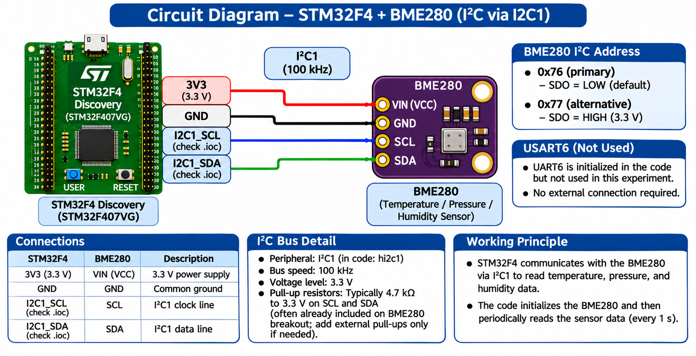

# EXPERIMENT DETAILS

**EXP:** CONTINUOUS LAB EVALUATION 12

**DATE:** 23/10/2026

**NAME OF EXP:** Sensor Interfacing (BME280) – STM32 (Debug) – ESP8266 (Wi-Fi) HTTP – Node Analytics

**HARDWARE SETUP / PLATFORM:** STM32 Nucleo Development Board + BME280 Sensor + STM32CubeMX + Keil MDK + STM32 HAL Libraries + Bosch BME280 Sensor API

---

## TASK : BME280 Sensor Interfacing Using I²C and Bosch Sensor API

### 1. Circuit Diagram

The BME280 sensor is interfaced with the STM32 development board through the I²C communication protocol to measure temperature, atmospheric pressure, and relative humidity.

**Connections:**

- BME280 VCC → Appropriate power supply
- BME280 GND → STM32 GND
- BME280 SDA → STM32 I²C SDA
- BME280 SCL → STM32 I²C SCL

The exact GPIO pins depend on the STM32CubeMX I²C configuration.



### 2. Core Logic / Pseudocode / Code Base

**Working Principle:**

The STM32 microcontroller communicates with the BME280 environmental sensor using I²C.

The official Bosch BME280 Sensor API is integrated into the STM32 project to perform sensor initialization, register communication, configuration, and compensation of raw sensor data.

The STM32 initializes the I²C interface, verifies the sensor chip ID, and configures temperature, pressure, and humidity oversampling.

The sensor is placed in normal operating mode, and compensated temperature, pressure, and humidity values are read periodically.

**Pseudocode:**

1. Initialize the STM32 HAL library.
2. Configure the system clock and GPIO.
3. Initialize the I²C1 peripheral.
4. Add the Bosch BME280 driver files to the project.
5. Configure I²C read, write, and delay callback functions.
6. Read and verify the BME280 chip ID.
7. Initialize the BME280 sensor.
8. Configure temperature, pressure, and humidity oversampling.
9. Configure the filter and normal operating mode.
10. Read the sensor data using the Bosch API.
11. Obtain compensated temperature, pressure, and humidity values.
12. Repeat the measurement every second.

**Code Base:**

**Required Bosch Driver Files:**

```text
bme280.c
bme280.h
bme280_defs.h
```

**Project File Structure:**

```text
Core/
├── Inc/
│   ├── bme280.h
│   └── bme280_defs.h
└── Src/
    └── bme280.c
```

**STM32 Initialization:**

```c
HAL_Init();
SystemClock_Config();
MX_GPIO_Init();
MX_I2C1_Init();
```

**BME280 Driver Initialization:**

```c
static uint8_t dev_addr = BME280_I2C_ADDR_PRIM;

dev.intf_ptr = &dev_addr;
dev.intf = BME280_I2C_INTF;
dev.read = user_i2c_read;
dev.write = user_i2c_write;
dev.delay_us = user_delay_us;

rslt = bme280_init(&dev);
```

**Sensor Configuration:**

The exact function signatures depend on the Bosch BME280 API version used in the project.

```c
dev.settings.osr_h = BME280_OVERSAMPLING_1X;
dev.settings.osr_p = BME280_OVERSAMPLING_1X;
dev.settings.osr_t = BME280_OVERSAMPLING_1X;
dev.settings.filter = BME280_FILTER_COEFF_OFF;

rslt = bme280_set_sensor_settings(
    BME280_SEL_OSR_PRESS |
    BME280_SEL_OSR_TEMP |
    BME280_SEL_OSR_HUM |
    BME280_SEL_FILTER,
    &dev
);

rslt = bme280_set_sensor_mode(
    BME280_MODE_NORMAL,
    &dev
);
```

**Sensor Data Acquisition:**

```c
while (1)
{
    rslt = bme280_get_sensor_data(
        BME280_ALL,
        &comp_data,
        &dev
    );

    if (rslt == BME280_OK)
    {
        temperature = comp_data.temperature;
        pressure = comp_data.pressure / 100.0f;
        humidity = comp_data.humidity;
    }

    HAL_Delay(1000);
}
```

**Expected Measurement Format:**

```text
Temperature : XX.XX °C
Pressure    : XXXX.XX hPa
Humidity    : XX.XX %RH
```

### 3. Inference

The experiment demonstrates the interfacing of a BME280 environmental sensor with an STM32 microcontroller using I²C communication.

The Bosch BME280 Sensor API simplifies sensor configuration and compensation of temperature, pressure, and humidity measurements.

The application provides the foundation for environmental monitoring and further integration with Wi-Fi-based IoT systems.