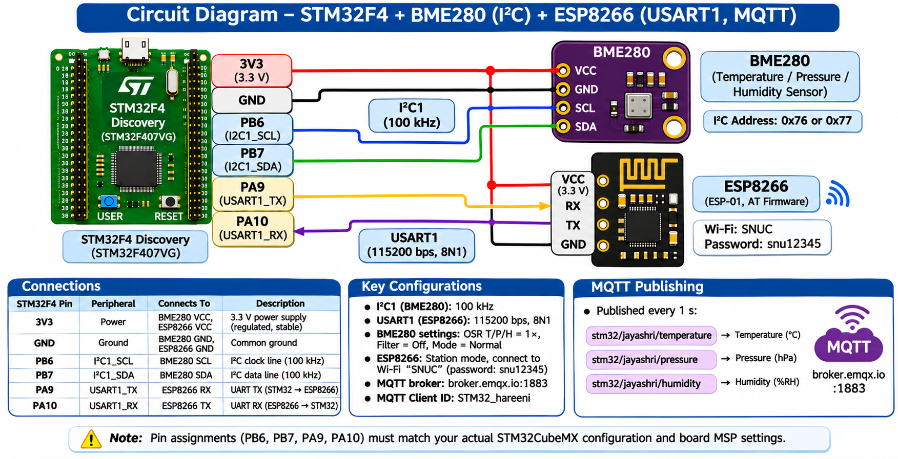

# EXPERIMENT DETAILS

**EXP:** CONTINUOUS LAB EVALUATION 13

**DATE:** 27/10/2026

**NAME OF EXP:** Sensor Interfacing (BME280) – MQTT – Node Analytics

**HARDWARE SETUP / PLATFORM:** STM32F4 Development Board + BME280 Sensor + ESP8266 Wi-Fi Module + STM32CubeMX + Keil MDK + STM32 HAL Libraries + Bosch BME280 Driver + Custom ESP8266 MQTT Library

---

## TASK 13 : BME280 Sensor Data Acquisition and MQTT Publishing

### 1. Circuit Diagram

The STM32F4 microcontroller communicates with the BME280 environmental sensor using the I²C protocol and with the ESP8266 Wi-Fi module using UART.

The ESP8266 connects to an MQTT broker through Wi-Fi and publishes the sensor readings.

**Connections:**

- BME280 SDA → STM32 PB9 (I²C1 SDA)
- BME280 SCL → STM32 PB8 (I²C1 SCL)
- BME280 VCC → Appropriate sensor supply
- BME280 GND → STM32 GND
- ESP8266 TX → STM32 USART1 RX
- ESP8266 RX → STM32 USART1 TX
- ESP8266 GND → STM32 GND

**Communication Flow:**

```text
BME280 Sensor
      |
      | I2C1
      v
STM32F4 Microcontroller
      |
      | USART1 (115200 baud)
      v
ESP8266 Wi-Fi Module
      |
      | Wi-Fi / MQTT
      v
MQTT Broker (broker.emqx.io)
      |
      v
Topic: stm32/harini
```



### 2. Core Logic / Pseudocode / Code Base

**Working Principle:**

The STM32F4 microcontroller interfaces with the BME280 sensor through I²C1 to acquire temperature, humidity, and atmospheric pressure.

The program checks the two possible BME280 I²C addresses, `0x76` and `0x77`, and selects the detected address.

The BME280 driver is initialized, the chip ID is verified, and the sensor is configured for normal operating mode with 1× oversampling.

The STM32 then initializes the ESP8266 module through USART1 and connects it to a Wi-Fi network.

A TCP connection is established with the MQTT broker `broker.emqx.io` on port `1883`.

The MQTT client connects using the client ID `STM32_Publisher`.

Every second, the STM32 reads the BME280 measurements, formats the values into a JSON payload, and publishes the payload to the MQTT topic `stm32/harini` using QoS 0.

**Pseudocode:**

1. Initialize the STM32 HAL library.
2. Configure the system clock.
3. Initialize GPIO, I²C1, and USART1.
4. Check for the BME280 sensor at addresses `0x76` and `0x77`.
5. Configure the BME280 I²C read, write, and delay functions.
6. Initialize the BME280 sensor.
7. Verify the BME280 chip ID (`0x60`).
8. Configure temperature, pressure, and humidity oversampling.
9. Set the sensor to normal operating mode.
10. Initialize the ESP8266 in station mode.
11. Connect the ESP8266 to the Wi-Fi network.
12. Establish a TCP connection to the MQTT broker.
13. Configure the MQTT client and connect to the broker.
14. Read temperature, pressure, and humidity every second.
15. Convert the sensor readings into JSON format.
16. Publish the JSON payload to the MQTT topic.
17. Repeat the process continuously.

**Code Base:**

**Required Libraries:**

```c
#include "main.h"
#include "ESPLib.h"
#include "bme280.h"
#include <stdint.h>
#include <stdio.h>
```

**BME280 Address Detection:**

```c
address_76_status = HAL_I2C_IsDeviceReady(
    &hi2c1, (uint16_t)(0x76U << 1), 3, 100);

address_77_status = HAL_I2C_IsDeviceReady(
    &hi2c1, (uint16_t)(0x77U << 1), 3, 100);

if (address_76_status == HAL_OK)
    detected_address = 0x76;
else if (address_77_status == HAL_OK)
    detected_address = 0x77;
else
    Error_Handler();
```

**BME280 Initialization:**

```c
dev.intf_ptr = &dev_addr;
dev.intf = BME280_I2C_INTF;
dev.read = user_i2c_read;
dev.write = user_i2c_write;
dev.delay_us = user_delay_us;

rslt = bme280_init(&dev);
```

**Sensor Configuration:**

```c
settings.osr_t = BME280_OVERSAMPLING_1X;
settings.osr_p = BME280_OVERSAMPLING_1X;
settings.osr_h = BME280_OVERSAMPLING_1X;
settings.filter = BME280_FILTER_COEFF_OFF;

rslt = bme280_set_sensor_settings(
    BME280_SEL_OSR_PRESS |
    BME280_SEL_OSR_TEMP |
    BME280_SEL_OSR_HUM |
    BME280_SEL_FILTER,
    &settings,
    &dev
);

rslt = bme280_set_sensor_mode(
    BME280_POWERMODE_NORMAL,
    &dev
);
```

**ESP8266 and MQTT Initialization:**

```c
ESP8266_Init(StationMode, huart1);

ESP8266_wifiConnect("YOUR_SSID", "YOUR_PASSWORD");

ESP8266_portConnect(
    "TCP", "broker.emqx.io", "1883"
);

MQTT_InitTypeDef_t mqttSetting;
mqttSetting.keepAlive = 500;
mqttSetting.connectFlag = CleanSession;
mqttSetting.clientID = "STM32_Publisher";

MQTT_connectBroker(&mqttSetting);
```

**Sensor Reading and MQTT Publishing:**

```c
rslt = bme280_get_sensor_data(
    BME280_ALL, &comp_data, &dev
);

if (rslt == BME280_OK)
{
    temperature = comp_data.temperature;
    pressure = comp_data.pressure / 100.0f;
    humidity = comp_data.humidity;

    build_payload(
        payload, sizeof(payload),
        temperature, humidity, pressure
    );

    MQTT_publishTopic(
        "stm32/harini", payload, QoS0
    );
}
```

**MQTT Configuration:**

```text
Broker       : broker.emqx.io
Port         : 1883
Client ID    : STM32_Publisher
Topic        : stm32/harini
QoS          : 0
Interval     : 1000 milliseconds
Payload Type : JSON
```

**Example JSON Payload:**

```json
{
  "temperature": 28.45,
  "humidity": 60.12,
  "pressure": 1008.23
}
```

The numerical values are examples. Actual values depend on the BME280 sensor measurements.

### 3. Inference

The experiment demonstrates the integration of a BME280 environmental sensor with an STM32F4 microcontroller and an ESP8266 Wi-Fi module.

The STM32 acquires temperature, humidity, and pressure measurements through I²C and formats the sensor readings into JSON.

The ESP8266 provides wireless connectivity, allowing the STM32 to publish environmental data to an MQTT broker using the MQTT publish–subscribe communication model.

The implementation covers sensor acquisition and MQTT publishing. MQTT subscription and Node-RED analytics are additional parts of the CAT13 evaluation and are not implemented in the supplied program.