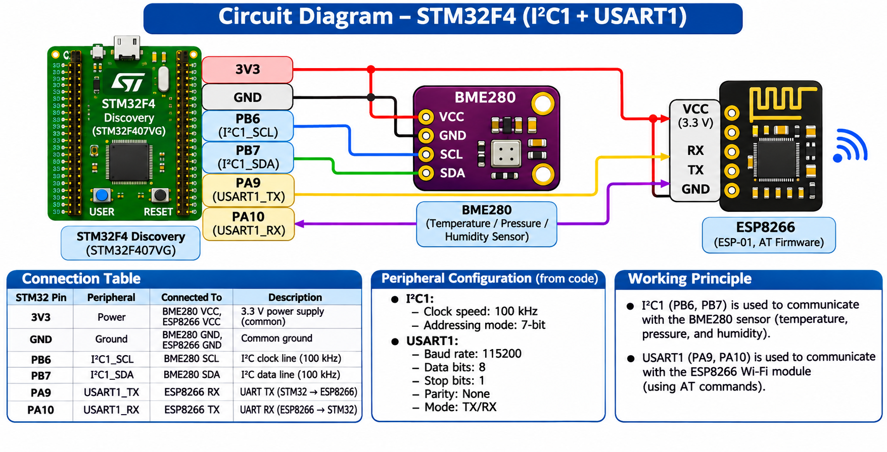

# EXPERIMENT DETAILS

**EXP:** CONTINUOUS LAB EVALUATION 15 – PROJECT

**NAME OF EXP:** IoT Weather Station with Indoor vs Outdoor Analysis

**HARDWARE SETUP / PLATFORM:** STM32F4 Microcontroller, BME280 Sensor, ESP8266 Wi-Fi Module, STM32CubeMX, Keil µVision, STM32 HAL, MQTT, Node-RED Dashboard 2.0

---

## PROJECT: IoT WEATHER STATION WITH INDOOR VS OUTDOOR ANALYSIS

### 1. Circuit Diagram

The system uses an STM32 microcontroller to collect indoor environmental data from a BME280 sensor and transmit it to an MQTT broker through an ESP8266 Wi-Fi module.

**Hardware Connections**

| Component | STM32 Pin | Function |
|---|---|---|
| BME280 SCL | PB6 | I²C1 Clock |
| BME280 SDA | PB7 | I²C1 Data |
| BME280 VCC | 3.3 V | Power Supply |
| BME280 GND | GND | Ground |
| ESP8266 RX | PA9 (USART1 TX) | UART Transmission |
| ESP8266 TX | PA10 (USART1 RX) | UART Reception |
| ESP8266 VCC | 3.3 V | Power Supply |
| ESP8266 GND | GND | Common Ground |

The ESP8266 requires a stable 3.3 V power supply. All connected modules must share a common ground.

**Circuit Diagram:**



**System Architecture**

```text
BME280 Sensor
     |
     | I2C
     v
STM32 Microcontroller
     |
     | UART
     v
ESP8266 Wi-Fi Module
     |
     | Wi-Fi
     v
MQTT Broker (broker.emqx.io:1883)
     |
     | MQTT Subscribe
     v
Node-RED <------ HTTP ------ Outdoor Weather API
     |
     v
Flow Memory
     |
     v
Decision Function
     |
     v
Node-RED Dashboard 2.0
```

### 2. Core Logic / Pseudocode / Code Base

**Working Principle:**

The IoT Weather Station measures indoor temperature, humidity, and atmospheric pressure using a BME280 sensor connected to an STM32 microcontroller through I²C communication.

The STM32 processes the sensor readings and sends them to an ESP8266 Wi-Fi module through UART communication.

The ESP8266 establishes an internet connection and publishes the sensor values to the MQTT broker `broker.emqx.io` on port `1883`.

Node-RED subscribes to the MQTT topics to receive indoor sensor readings. It also retrieves outdoor temperature and humidity from an online weather API using an HTTP request.

The latest indoor and outdoor readings are stored in Node-RED flow memory. A decision function compares the values and recommends suitable actions such as turning on the AC, turning on the fan, ventilating the room, or using a dehumidifier.

The recommendations are displayed on the Node-RED Dashboard 2.0.

**Pseudocode:**

```text
START

Initialize STM32 HAL
Configure system clock to 84 MHz
Initialize GPIO, I2C1 and USART1

Detect BME280 at address 0x76 or 0x77
Initialize BME280 sensor
Configure oversampling and normal mode

Initialize ESP8266
Connect ESP8266 to Wi-Fi

Connect to MQTT broker
broker.emqx.io:1883

LOOP every 1 second:

    Read indoor temperature
    Read indoor humidity
    Read indoor pressure

    Convert readings to text

    Publish temperature to MQTT
    Publish humidity to MQTT
    Publish pressure to MQTT

END LOOP

NODE-RED:

    Subscribe to indoor MQTT topics

    Fetch outdoor weather using HTTP API

    Store indoor and outdoor readings

    Every 5 seconds:
        Calculate temperature difference
        Calculate humidity difference

        Apply decision rules

        Display recommendations on dashboard

END
```

**Code Base:**

**BME280 Sensor Initialization**

The firmware checks the possible BME280 I²C addresses `0x76` and `0x77`, initializes the Bosch sensor driver, and configures the sensor with 1× oversampling, filter disabled, and normal operating mode.

**MQTT Configuration**

Broker:

```text
broker.emqx.io
```

Port:

```text
1883
```

**MQTT Topics Published**

| Topic | Data |
|---|---|
| `stm32/jayashri/temperature` | Indoor temperature (°C) |
| `stm32/jayashri/pressure` | Atmospheric pressure (hPa) |
| `stm32/jayashri/humidity` | Relative humidity (%RH) |

The STM32 publishes each measurement approximately once per second.

**Node-RED Flow**

The Node-RED application contains:

1. Three `mqtt in` nodes for indoor temperature, pressure, and humidity.
2. An `inject2` node to trigger the outdoor weather API request.
3. An `http request` node to retrieve outdoor weather information.
4. A `json_split` function to extract weather values.
5. Change nodes to store readings in flow memory.
6. An `ac_fan_decision` function to compare indoor and outdoor conditions.
7. Four `ui-text` widgets to display readings and recommended actions.

**Flow Memory Variables**

```text
flow.bme_temp
flow.bme_pressure
flow.bme_humidity

flow.weather_temp
flow.weather_humidity
```

**Decision Logic**

Temperature difference:

```text
Temperature Difference =
Indoor Temperature - Outdoor Temperature
```

| Condition | Recommended Action |
|---|---|
| Indoor temperature ≥ 30 °C or difference ≥ 10 °C | AC ON |
| Difference ≥ 3 °C | FAN ON |
| Difference ≤ -3 °C | AC / FAN OFF |
| Otherwise | NO ACTION |

Humidity difference:

```text
Humidity Difference =
Indoor Humidity - Outdoor Humidity
```

| Condition | Recommended Action |
|---|---|
| Indoor humidity > 70% and difference ≥ 15% | Ventilate / Dehumidifier ON |
| Indoor humidity > 70% | Dehumidifier ON |
| Humidity difference ≥ 15% | Ventilate |
| Indoor humidity < 30% | Humidifier ON |
| Otherwise | NO ACTION |

The thresholds are configurable through the following constants:

```text
AC_DIFF
FAN_DIFF
AC_ABS
HUM_HIGH
HUM_LOW
HUM_DIFF
```

**Example Observation**

| Parameter | Indoor | Outdoor |
|---|---|---|
| Temperature | 27.48 °C | 28.93 °C |
| Humidity | 61.34% | 79% |

Temperature difference:

```text
27.48 - 28.93 = -1.45 °C
```

Humidity difference:

```text
61.34 - 79 = -17.66%
```

**Recommended Output:**

```text
Temperature Action: NO ACTION
Humidity Action: NO ACTION
```

**Execution Procedure:**

1. Configure the STM32 project using STM32CubeMX.
2. Compile and flash the firmware using Keil µVision.
3. Connect the BME280 sensor and ESP8266 module.
4. Establish the Wi-Fi and MQTT connections.
5. Open MQTTX and subscribe to `stm32/jayashri/#`.
6. Verify that the temperature, pressure, and humidity readings are received.
7. Start Node-RED and deploy the flow.
8. Trigger the weather API request using `inject2`.
9. Verify that indoor and outdoor readings are stored in flow memory.
10. Open Node-RED Dashboard 2.0 to observe the comparison and recommendations.

### 3. Inference

The project demonstrates the integration of sensor interfacing, wireless communication, MQTT messaging, HTTP weather data retrieval, and real-time data analytics.

The BME280 sensor provides indoor temperature, pressure, and humidity measurements, while the ESP8266 enables the STM32 to transmit readings over Wi-Fi.

The MQTT protocol allows Node-RED to receive sensor measurements, and the outdoor weather API provides environmental data for comparison.

The Node-RED decision function analyzes the difference between indoor and outdoor conditions and displays recommendations for improving indoor comfort.

The project successfully illustrates the architecture of an IoT-based environmental monitoring and decision-support system.

The recommendations are displayed on the dashboard and do not directly operate physical AC, fan, or ventilation equipment.
