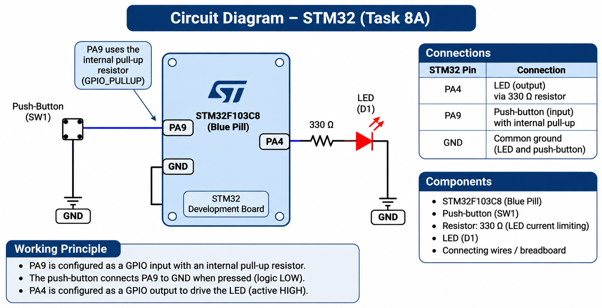

# EXPERIMENT DETAILS

**EXP:** CONTINUOUS LAB EVALUATION 8

**DATE:** 18/09/2026

**NAME OF EXP:** STM32 GPIO Bring-Up and Switch-Controlled LED

**HARDWARE SETUP / PLATFORM:** STM32 Development Board (Blue Pill / Nucleo), Push-Button, LED, STM32CubeMX, Keil MDK, Embedded C, STM32 HAL Libraries

---

## TASK 8A : GPIO Input/Output

### 1. Circuit Diagram

A push-button and LED are interfaced with the STM32 development board.

**Connections:**

- Push-button → STM32 GPIO input pin
- LED → STM32 GPIO output pin
- Common ground → STM32 GND
- Appropriate pull-up or pull-down configuration for the push-button
- Current-limiting resistor for an external LED

The exact GPIO pins depend on the STM32 board and CubeMX configuration.



### 2. Core Logic / Pseudocode / Code Base

**Working Principle:**

The experiment demonstrates GPIO input and output operations using an STM32 microcontroller.

A push-button is configured as a digital input, and an LED is configured as a digital output using STM32CubeMX.

The microcontroller continuously reads the push-button state using `HAL_GPIO_ReadPin()`.

When the push-button is pressed, the LED turns ON. When the push-button is released, the LED turns OFF.

Thus, the LED directly follows the switch state.

**Pseudocode:**

1. Start the program.
2. Initialize the STM32 HAL library.
3. Configure the system clock.
4. Initialize the GPIO peripheral.
5. Configure the push-button pin as GPIO input.
6. Configure the LED pin as GPIO output.
7. Read the push-button state.
8. If the button is pressed, turn ON the LED.
9. Otherwise, turn OFF the LED.
10. Repeat continuously.

**Code Base:**

**STM32 Initialization:**

```c
HAL_Init();
SystemClock_Config();
MX_GPIO_Init();
```

**Main Logic:**

The following example assumes an active-high button and an active-high LED. Replace the pin labels with those generated by STM32CubeMX.

```c
while (1)
{
    GPIO_PinState buttonState =
        HAL_GPIO_ReadPin(BUTTON_GPIO_Port, BUTTON_Pin);

    if (buttonState == GPIO_PIN_SET)
    {
        HAL_GPIO_WritePin(
            LED_GPIO_Port,
            LED_Pin,
            GPIO_PIN_SET
        );
    }
    else
    {
        HAL_GPIO_WritePin(
            LED_GPIO_Port,
            LED_Pin,
            GPIO_PIN_RESET
        );
    }
}
```

**Expected Output:**

| Push-Button State | LED State |
|---|---|
| Pressed | ON |
| Released | OFF |

### 3. Inference

The experiment demonstrates the use of STM32 GPIO pins for digital input and output operations.

The push-button provides a digital input to the microcontroller, and the LED is controlled according to the detected switch state.

The task illustrates basic GPIO configuration, input reading, and output control using STM32 HAL libraries.
