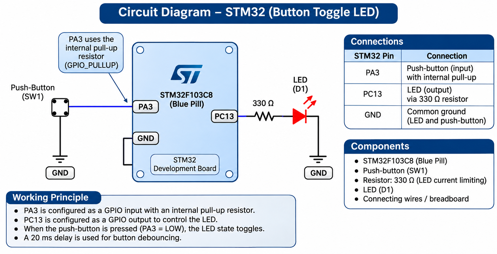

# EXPERIMENT DETAILS

**EXP:** CONTINUOUS LAB EVALUATION 8

**DATE:** 18/09/2026

**NAME OF EXP:** STM32 GPIO Bring-Up and Switch-Controlled LED

**HARDWARE SETUP / PLATFORM:** STM32 Development Board (Blue Pill / Nucleo), Push-Button, LED, STM32CubeMX, Keil MDK, Embedded C, STM32 HAL Libraries

---

## TASK 8B : Event-Based Control

### 1. Circuit Diagram

A push-button and LED are interfaced with the STM32 development board using GPIO pins.

**Connections:**

- Push-button → STM32 GPIO input pin
- LED → STM32 GPIO output pin
- Push-button pull-up or pull-down resistor as required
- External LED current-limiting resistor
- Common ground → STM32 GND

The GPIO pins are configured using STM32CubeMX according to the development board.



### 2. Core Logic / Pseudocode / Code Base

**Working Principle:**

The experiment demonstrates event-based LED control using a push-button connected to an STM32 microcontroller.

Unlike Task 8A, where the LED follows the switch state, Task 8B requires the LED to toggle its state whenever a valid button press occurs.

When the push-button is pressed once, the LED changes from OFF to ON or from ON to OFF. The LED retains its new state after the button is released.

Mechanical push-buttons may generate multiple rapid transitions due to switch bounce. Software debouncing is implemented to prevent a single physical press from producing multiple LED toggles.

The microcontroller detects a valid button-press event and uses `HAL_GPIO_TogglePin()` to change the LED state.

**Pseudocode:**

1. Start the program.
2. Initialize the STM32 HAL library.
3. Configure the system clock.
4. Initialize the GPIO pins.
5. Configure the push-button as a digital input.
6. Configure the LED as a digital output.
7. Continuously monitor the push-button.
8. Detect a transition from released to pressed.
9. Wait for a short debounce interval.
10. Confirm that the button is still pressed.
11. Toggle the LED state once.
12. Wait for the button to be released before accepting another press.
13. Repeat continuously.

**Code Base:**

**STM32 Initialization:**

```c
HAL_Init();
SystemClock_Config();
MX_GPIO_Init();
```

**Main Logic:**

The following example assumes an active-high push-button and uses a 20 ms software debounce interval. Replace the pin labels with the GPIO names configured in STM32CubeMX.

```c
uint8_t button_ready = 1;

while (1)
{
    GPIO_PinState buttonState =
        HAL_GPIO_ReadPin(BUTTON_GPIO_Port, BUTTON_Pin);

    if (button_ready && buttonState == GPIO_PIN_SET)
    {
        HAL_Delay(20);

        if (HAL_GPIO_ReadPin(BUTTON_GPIO_Port,
                             BUTTON_Pin) == GPIO_PIN_SET)
        {
            HAL_GPIO_TogglePin(LED_GPIO_Port, LED_Pin);
            button_ready = 0;
        }
    }

    if (!button_ready && buttonState == GPIO_PIN_RESET)
    {
        HAL_Delay(20);

        if (HAL_GPIO_ReadPin(BUTTON_GPIO_Port,
                             BUTTON_Pin) == GPIO_PIN_RESET)
        {
            button_ready = 1;
        }
    }
}
```

**Expected Output:**

| User Action | LED Response |
|---|---|
| First valid button press | LED toggles ON |
| Button released | LED remains ON |
| Second valid button press | LED toggles OFF |
| Button released | LED remains OFF |
| Switch bounce | No additional toggles |

### 3. Inference

The experiment demonstrates event-based GPIO control using an STM32 microcontroller.

A valid push-button press is used to toggle the LED state instead of continuously following the switch level.

Software debouncing prevents unwanted multiple toggles caused by mechanical switch bounce.

The task illustrates button-event detection, GPIO output toggling, and reliable digital input handling using STM32 HAL libraries.
