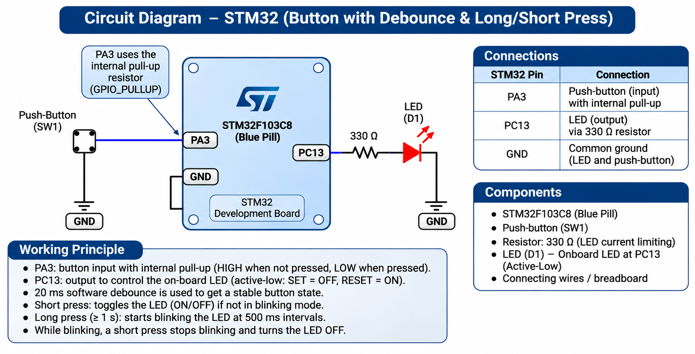

# EXPERIMENT DETAILS

**EXP:** CONTINUOUS LAB EVALUATION 8

**DATE:** 18/09/2026

**NAME OF EXP:** STM32 GPIO Bring-Up and Switch-Controlled LED

**HARDWARE SETUP / PLATFORM:** STM32 Development Board (Blue Pill / Nucleo), Push-Button, LED, STM32CubeMX, Keil MDK, Embedded C, STM32 HAL Libraries

---

## TASK 8C : Short Press vs Long Press

### 1. Circuit Diagram

A push-button and LED are interfaced with the STM32 microcontroller using GPIO pins.

**Connections:**

- Push-button → STM32 GPIO input pin
- LED → STM32 GPIO output pin
- Appropriate pull-up or pull-down resistor for the push-button
- Current-limiting resistor for an external LED
- Common ground → STM32 GND

The exact GPIO pins depend on the STM32 development board and STM32CubeMX configuration.



### 2. Core Logic / Pseudocode / Code Base

**Working Principle:**

The experiment demonstrates the detection of short and long button presses using an STM32 microcontroller.

The push-button is configured as a GPIO input, and the LED is configured as a GPIO output.

The duration of each button press is measured using `HAL_GetTick()`, which provides a millisecond time reference.

The button press is classified into two categories:

- **Short Press:** Button pressed for less than 1 second.
- **Long Press:** Button pressed for 1 second or more.

**System Response:**

| User Action | System Response |
|---|---|
| Short press | Toggle LED |
| Long press | LED enters continuous blinking mode |
| Next short press | Stop blinking |
| Long press again | Return to blinking mode |

The application uses non-blocking timing to detect button presses and control LED blinking without interrupting the main program.

**Pseudocode:**

1. Start the program.
2. Initialize the STM32 HAL library.
3. Configure the system clock.
4. Initialize the GPIO pins.
5. Configure the push-button as input and LED as output.
6. Monitor the push-button continuously.
7. When the button is pressed, record the starting time using `HAL_GetTick()`.
8. Continue executing the application while the button remains pressed.
9. When the button is released, record the release time.
10. Calculate the duration:

   `Press Duration = Release Time - Start Time`

11. If the duration is less than 1000 ms, classify it as a short press.
12. If the duration is 1000 ms or more, classify it as a long press.
13. For a short press, toggle the LED or stop blinking if blinking mode is active.
14. For a long press, activate blinking mode.
15. Repeat continuously.

**Code Base:**

**STM32 Initialization:**

```c
HAL_Init();
SystemClock_Config();
MX_GPIO_Init();
```

**Button Press Detection and LED Control:**

The following example assumes an active-high push-button and an active-high LED. Replace the GPIO pin labels with those generated by STM32CubeMX.

```c
uint32_t pressStart = 0;
uint32_t lastBlink = 0;
uint32_t debounceStart = 0;

uint8_t buttonPressed = 0;
uint8_t blinkingMode = 0;
uint8_t lastRawState = 0;
uint8_t stableState = 0;

while (1)
{
    uint32_t currentTime = HAL_GetTick();

    uint8_t rawState =
        HAL_GPIO_ReadPin(BUTTON_GPIO_Port, BUTTON_Pin)
        == GPIO_PIN_SET;

    /* Non-blocking software debounce */
    if (rawState != lastRawState)
    {
        debounceStart = currentTime;
        lastRawState = rawState;
    }

    if ((currentTime - debounceStart >= 20) &&
        (rawState != stableState))
    {
        stableState = rawState;

        if (stableState)
        {
            pressStart = currentTime;
            buttonPressed = 1;
        }
        else if (buttonPressed)
        {
            uint32_t duration = currentTime - pressStart;
            buttonPressed = 0;

            if (duration < 1000)
            {
                if (blinkingMode)
                {
                    blinkingMode = 0;

                    HAL_GPIO_WritePin(
                        LED_GPIO_Port,
                        LED_Pin,
                        GPIO_PIN_RESET
                    );
                }
                else
                {
                    HAL_GPIO_TogglePin(
                        LED_GPIO_Port,
                        LED_Pin
                    );
                }
            }
            else
            {
                blinkingMode = 1;
                lastBlink = currentTime;
            }
        }
    }

    /* Non-blocking LED blinking */
    if (blinkingMode &&
        (currentTime - lastBlink >= 500))
    {
        lastBlink = currentTime;

        HAL_GPIO_TogglePin(
            LED_GPIO_Port,
            LED_Pin
        );
    }
}
```

**Expected Output:**

| Button Action | Expected LED Behaviour |
|---|---|
| Short press (less than 1 second) | LED toggles ON/OFF |
| Long press (1 second or more) | LED starts continuous blinking |
| Short press during blinking | LED stops blinking |
| Long press after blinking stops | LED starts blinking again |

**Important Constraint:**

A blocking delay must not be used to determine whether the button press is short or long.

The `HAL_GetTick()` function is used to measure elapsed time without blocking program execution.

### 3. Inference

The experiment demonstrates short-press and long-press detection using an STM32 microcontroller.

The duration of a button press is measured using `HAL_GetTick()` and classified based on a 1000 ms threshold.

Short presses are used to toggle the LED or stop blinking, while long presses activate continuous blinking mode.

The experiment illustrates GPIO input handling, software debouncing, event-based control, and non-blocking timing using STM32 HAL libraries.
