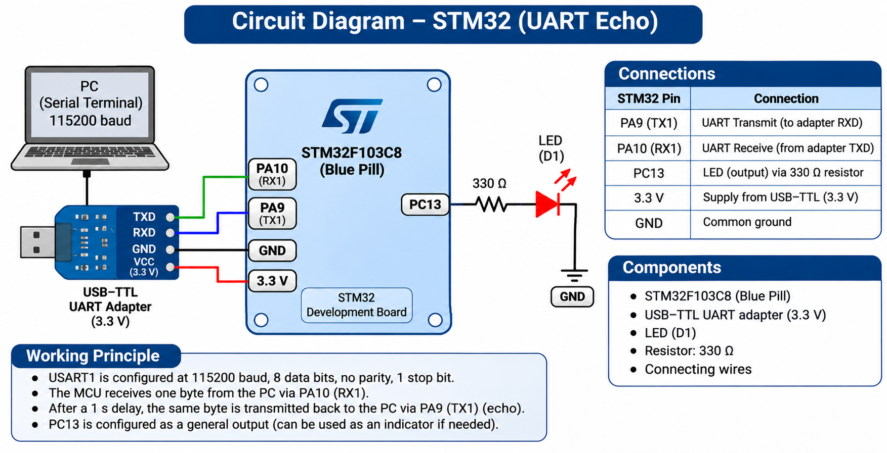

# EXPERIMENT DETAILS

**EXP:** CONTINUOUS ASSESSMENT 9

**DATE:** 28/09/2026

**NAME OF EXP:** UART Receive and Echo Using STM32

**HARDWARE SETUP / PLATFORM:** STM32 Development Board + STM32CubeMX + Keil µVision + UART Serial Terminal

---

## TASK 9A : UART Receive and Echo

### 1. Circuit Diagram

The experiment demonstrates UART serial communication between an STM32 microcontroller and a serial terminal using USART1.

- **Microcontroller:** STM32
- **Peripheral:** USART1
- **Baud Rate:** 115200
- **Data Bits:** 8
- **Stop Bits:** 1
- **Parity:** None
- **UART Mode:** Transmit and Receive

### 2. Core Logic / Pseudocode / Code Base

**Working Principle:**

The STM32 microcontroller communicates with a serial terminal using USART1.

The microcontroller receives one character through UART, waits for 1000 milliseconds, and transmits the same character back to the terminal.

Another delay of 1000 milliseconds is introduced before the next character is received.

This process repeats continuously.

**Pseudocode:**

1. Initialize the STM32 HAL library.
2. Configure the system clock.
3. Initialize GPIO and USART1.
4. Configure USART1 for 115200 baud.
5. Declare an 8-bit variable to store the received character.
6. Receive one character through USART1.
7. Introduce a delay of 1000 milliseconds.
8. Transmit the received character back through USART1.
9. Introduce another delay of 1000 milliseconds.
10. Repeat continuously.

**Code Base:**

- `HAL_Init()` initializes the HAL library.
- `SystemClock_Config()` configures the system clock.
- `MX_GPIO_Init()` initializes the GPIO pins.
- `MX_USART1_UART_Init()` initializes USART1.
- `uint8_t rx` stores the received character.
- `HAL_UART_Receive(&huart1, &rx, 1, HAL_MAX_DELAY)` receives one byte through UART.
- `HAL_Delay(1000)` introduces a delay of 1000 milliseconds.
- `HAL_UART_Transmit(&huart1, &rx, 1, HAL_MAX_DELAY)` transmits the received byte.
- `while(1)` continuously repeats the process.

### 3. Inference

The program demonstrates UART character reception and echo transmission using the STM32 USART1 peripheral.

The experiment illustrates basic serial communication using STM32 HAL functions and software delays.
