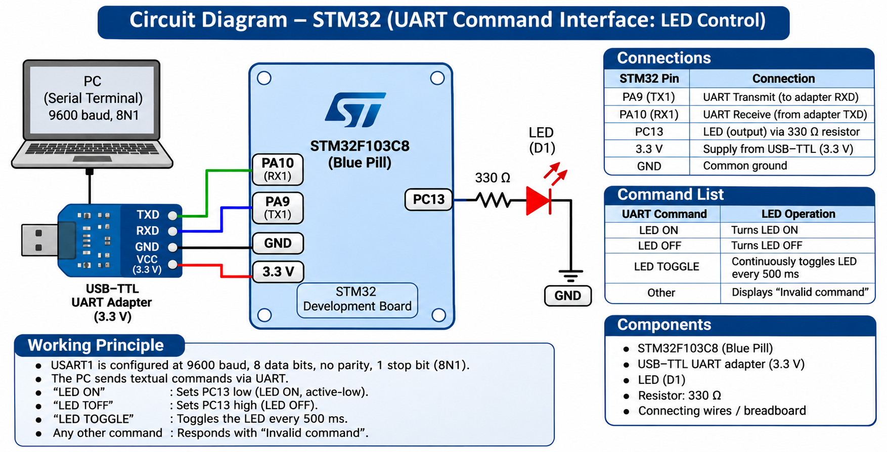

# EXPERIMENT DETAILS

**EXP:** CONTINUOUS ASSESSMENT 9

**DATE:** 28/09/2026

**NAME OF EXP:** UART String Command LED Control Using STM32

**HARDWARE SETUP / PLATFORM:** STM32 Development Board + STM32CubeMX + Keil µVision + UART Serial Terminal

---

## TASK 9B : UART String Command LED Control

### 1. Circuit Diagram

The experiment involves controlling an LED connected to the STM32 microcontroller by receiving string commands through UART.

- **Microcontroller:** STM32
- **Peripheral:** USART1
- **Communication:** UART Serial Communication
- **Output Peripheral:** LED
- **GPIO:** LED control pin configured as output
- **Input:** String commands received through UART

### 2. Core Logic / Pseudocode / Code Base

**Working Principle:**

The STM32 microcontroller receives string commands from a serial terminal through USART1.

The received command is stored in a character buffer and compared with predefined commands.

Based on the received command, the microcontroller changes the GPIO output state to control the LED.

The program continuously monitors incoming UART data and processes the received commands.

**Pseudocode:**

1. Initialize the STM32 HAL library.
2. Configure the system clock.
3. Initialize GPIO and USART1.
4. Configure the LED GPIO pin as an output.
5. Declare a character buffer to store the received command.
6. Receive a string command through UART.
7. Compare the received string with the predefined commands.
8. If the command requests LED ON, set the LED GPIO to its ON state.
9. If the command requests LED OFF, set the LED GPIO to its OFF state.
10. Repeat continuously.

**Code Base:**

The intended implementation uses Embedded C and STM32 HAL libraries.

- `HAL_Init()` initializes the HAL library.
- `SystemClock_Config()` configures the system clock.
- `MX_GPIO_Init()` initializes the GPIO pins.
- `MX_USART1_UART_Init()` initializes USART1.
- `HAL_UART_Receive()` receives UART data.
- A character buffer stores the received string.
- `strcmp()` can be used to compare the received command with predefined strings.
- `HAL_GPIO_WritePin()` controls the LED output state.
- `while(1)` continuously processes UART commands.

### 3. Inference

UART string commands can be used to control an LED connected to an STM32 GPIO pin.

The experiment demonstrates the use of serial communication, string comparison, and GPIO output control for command-based peripheral interfacing.
